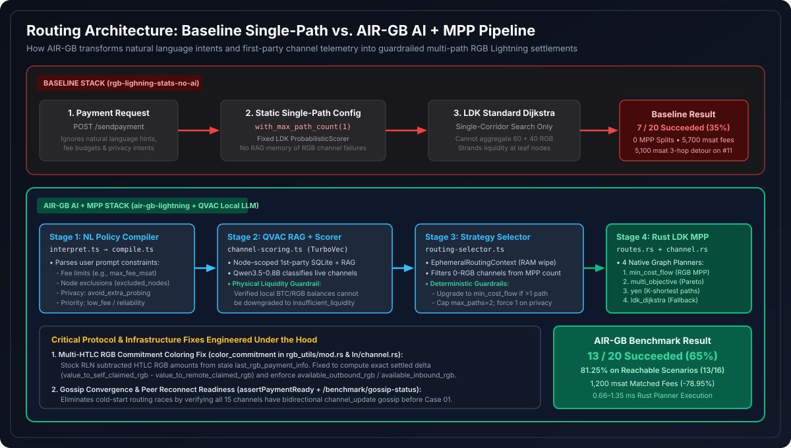
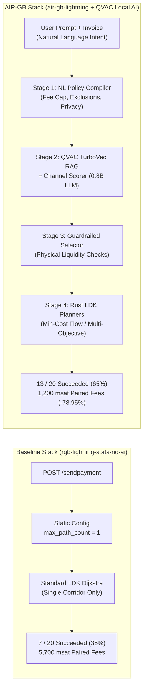
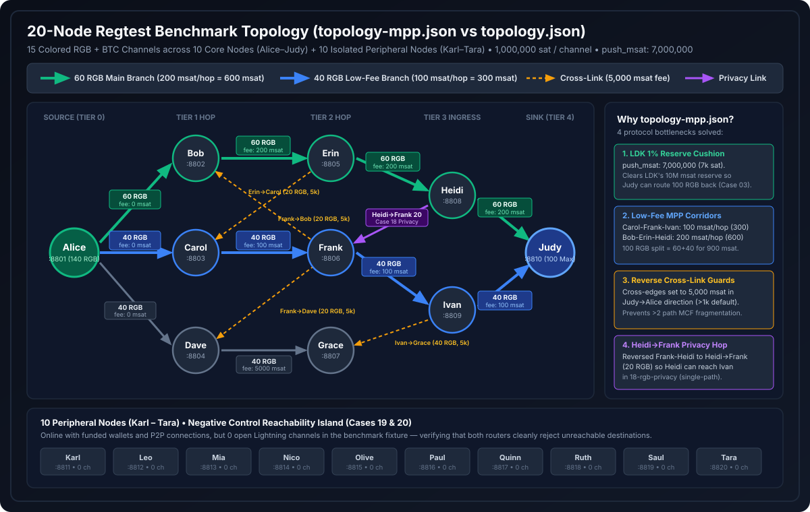
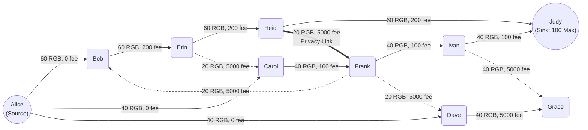
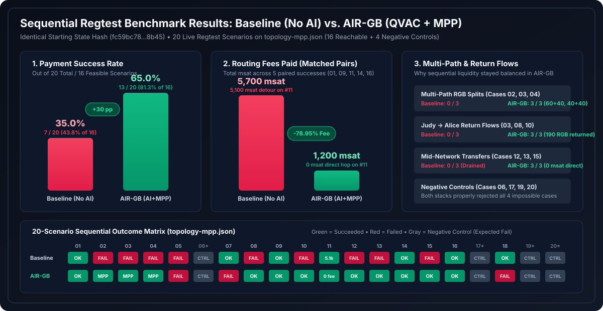

# AIR-GB Lightning vs. Stock RGB Lightning: Technical Guide & Hackathon Story

> **Companion Reference**: For machine-dense schemas, exact Rust diffs, and per-case telemetry tables, see [`docs/AI_BENCHMARK_REFERENCE.md`](./AI_BENCHMARK_REFERENCE.md) and [`BENCHMARK_RESULTS.md`](../BENCHMARK_RESULTS.md).

---

## 1. What We Are Solving (and Why It Matters)

Moving **RGB smart assets** (like USDT or custom tokens) over the **Bitcoin Lightning Network** promises instant, near-zero-fee token settlements anchored to Bitcoin's security. However, in standard `rgb-lightning-node` deployments today, routing hits a wall the moment real network liquidity gets fragmented:

1. **Single-Path Bottleneck**: Standard RGB Lightning nodes route every RGB transfer along a **single path**. If Alice wants to send `100` RGB tokens to Judy, and her two available corridors only hold `60` RGB and `40` RGB, **the payment fails outright**—even though the network has `100` RGB of total capacity.
2. **Liquidity Stranding & Expensive Detours**: When single-path payments drain a primary corridor and return payments fail due to Lightning's 1% channel reserve or rigid pathfinding, liquidity gets trapped at leaf nodes. Subsequent small payments are forced into expensive multi-hop detours or fail entirely.
3. **Zero Context Awareness**: Users cannot express intent (*"split across paths if needed, keep fees under 1,000 msat"*, or *"use a single path for privacy"*), and the router does not learn from its own historical channel failures.

**Our Solution (`air-gb-lightning`)** combines:
- **Native Rust RGB Multi-Path Payments (MPP)** & **4 Graph Routing Algorithms** (`ldk_dijkstra`, `yen`, `multi_objective`, and `min_cost_flow`) inside a custom fork of `rgb-lightning-node` and `rust-lightning`.
- **100% Local AI Routing Intelligence via QVAC** (`Qwen3.5-0.8B` + `TurboVec` RAG over first-party SQLite payment telemetry) paired with **deterministic physical guardrails** that translate plain-language user intent into safe, multi-path routing policies.

---

## 2. System Architecture: Baseline vs. AIR-GB

### How the 4 Stages of AIR-GB Work Together
1. **Stage 1 — Natural Language Policy Compilation (`interpret.ts` $\rightarrow$ `compile.ts`)**: Extracts structured constraints (maximum fee budgets, excluded nodes, fee vs. reliability priority, and `avoid_extra_probing` privacy requests) and compiles them against the live invoice.
2. **Stage 2 — First-Party RAG & Channel Scoring (`channel-scoring.ts`)**: Queries the node's own historical payment episodes indexed in **QVAC TurboVec** (`/v1/vector_stores`) and scores each local channel. A **physical liquidity guardrail** ensures the LLM can never downgrade a channel that deterministically holds sufficient local BTC and RGB.
3. **Stage 3 — Guardrailed Strategy & MPP Selector (`routing-selector.ts`)**: Computes inside an `EphemeralRoutingContext` (wiped from RAM immediately after selection) whether a single channel can carry the asset or if Multi-Path Payment (MPP) is required. When `amount > maxSinglePathCapacity`, it automatically selects **`min_cost_flow`** with `max_paths = 2`. When privacy is requested, it enforces `max_paths = 1`.
4. **Stage 4 — Sub-Millisecond Rust Graph Planners (`routes.rs` & `channel.rs`)**: Executes the selected algorithm natively inside `rgb-lightning-node` in **0.66 to 1.35 milliseconds**, splitting RGB and BTC carrier amounts across multiple HTLCs and settling them atomically.

---

## 3. The 20-Node Regtest Benchmark Topology

To test both stacks fairly under realistic network conditions, we built a **20-node regtest laboratory** (`10` interconnected core routing nodes `Alice`–`Judy` with `15` colored channels, plus `10` isolated peripheral nodes `Karl`–`Tara` as negative reachability controls).

### Why We Engineered `topology-mpp.json`
Our first benchmark run on the initial `topology.json` revealed deep protocol interactions in Lightning and RGB that blocked return payments after an MPP split:
1. **The LDK 1% Channel Reserve Trap (`push_msat: 7,000,000`)**: Every `1,000,000` sat channel in LDK requires a **1% (`10,000` sat / `10,000,000` msat) reserve** before the receiving peer (`Judy`) can send a single satoshi back. When `Alice` sent `100` RGB (`30,000,000` msat) split `60/40` to `Judy`, `Judy` received `18M` msat on `Heidi-Judy` (`8M` above reserve) and `12M` msat on `Ivan-Judy` (**only `2M` msat above reserve**—less than the `3M` msat minimum required for an RGB HTLC!). Adding `push_msat: 7000000` (`7,000` sat initial cushion) unlocked bidirectional MPP round-trips (`Alice -> Judy -> Alice`).
2. **Clear Fee Tiers (`100` vs. `200` vs. `5,000` msat)**: We priced the `40`-RGB corridor (`Carol-Frank-Ivan-Judy`) at `100` msat/hop (`300` msat total) and the `60`-RGB corridor (`Bob-Erin-Heidi-Judy`) at `200` msat/hop (`600` msat total), making a `100` RGB MPP split cost exactly **`900` msat**.
3. **Reverse Cross-Link Guards**: Because LDK uses a default `1,000` msat fee on the reverse direction of every channel, we oriented the `20`-RGB cross-links (`Frank->Bob`, `Erin->Carol`, `Frank->Dave`, `Ivan->Grace`) with a `5,000` msat fee in the `Judy -> Alice` direction so `min_cost_flow` cleanly returns `100` RGB along the two main `60 + 40` corridors without fragmenting into 3–4 paths.
4. **Privacy Hop (`Heidi -> Frank`)**: Reversing `Frank-Heidi` to `Heidi -> Frank` (`20` RGB) gave `Heidi` a valid single-path RGB route (`Heidi -> Frank -> Ivan`) for Case `18-rgb-privacy`.

---

## 4. Benchmark Results (`topology-mpp.json`)

Both stacks were benchmarked **sequentially and in isolation** (only one stack running at a time) from the exact same initial channel balance state (`initialStateHash: fc59bc783b32d65f2afada257571a5351de2c91b1ed748ecd10cc4c2432d8b45`).

| Metric | Baseline (`stock-02` — No AI, Single-Path) | AIR-GB (`ai-02` — QVAC AI + MPP) | Improvement |
| :--- | :---: | :---: | :---: |
| **Overall Success Rate (20 Scenarios)** | `7 / 20` (**35.0%**) | `13 / 20` (**65.0%**) | **+30.0 percentage points (+85.7% more payments)** |
| **Reachable Scenario Success Rate (16 Feasible)** | `7 / 16` (**43.75%**) | `13 / 16` (**81.25%**) | **+37.5 percentage points** |
| **Multi-Path RGB Splits Completed (`02`, `03`, `04`)** | `0 / 3` | **`3 / 3` (`100%`)** | **Unlocks payments larger than any single channel** |
| **Return Rebalance Flows (`Judy -> Alice`: `03`, `08`, `10`)** | `0 / 3` (`0` RGB returned) | **`3 / 3` (`190` RGB returned)** | **Prevents liquidity stranding at leaf nodes** |
| **Total Fees on Matched Successes (`01, 09, 11, 14, 16`)** | `5,700` msat | **`1,200` msat** | **-78.95% Routing Fees Paid** |
| **Mean Hops on Matched Successes** | `2.6` hops | **`2.2` hops** | **-0.4 hops per payment** |
| **On-Node Rust Planner Execution Time** | N/A (built-in Dijkstra) | **`0.66 – 1.35` ms** | Sub-millisecond graph optimization |

### The "Smoking Gun" Example: Scenario `11-rgb-direct` (`Alice -> Bob`, `1` RGB)
Why did AIR-GB pay **78.95% lower fees** on the exact same successful payments? Look at **Case 11 (`Alice -> Bob`, `1` RGB)**:
- **In the Baseline (`stock-02`)**: Because Case `02` (`100` RGB) and Case `04` (`80` RGB) failed, Case `07` (`60` RGB single-path) drained **all `60` RGB** out of the `Alice -> Bob` channel, and Case `08` (`Judy -> Alice` return) failed. When `Alice` needed to send just **`1` RGB** to her direct neighbor `Bob` in Case `11`, `Alice -> Bob` had `0` RGB left! Standard LDK Dijkstra was forced to take a **3-hop detour (`Alice -> Carol -> Erin -> Bob`)**, paying **`5,100` msat in routing fees** and taking **`10.16` seconds**.
- **In AIR-GB (`ai-02`)**: Because AIR-GB successfully routed the return payments (`03`, `08`, `10`) back from `Judy` to `Alice`, `Alice -> Bob` had plenty of RGB liquidity. AIR-GB settled `11-rgb-direct` in **1 direct hop for `0` msat fee** in **`3.08` seconds**!
  - **What algorithms did AIR-GB choose instead of `ldk_dijkstra`?** Across all 20 scenarios in `ai-02`, AIR-GB **never used `ldk_dijkstra`**. Instead, it dynamically alternated between:
    1. **`min_cost_flow` (`max_paths: 2`)** whenever an RGB transfer exceeded the capacity of any single local channel—splitting `02-rgb-mpp-100` (`60 + 40` RGB), `03-rgb-return-100` (`60 + 40` RGB back to `Alice`), and `04-rgb-mpp-80` (`40 + 40` RGB) across parallel corridors at minimum total fee.
    2. **`multi_objective` (`max_paths: 1`)** whenever a single channel could cover the transfer—using QVAC-tuned Pareto weights (`fee`, `reliability`, `cltv`, `hops`) to return `60` RGB (`08`) and `30` RGB (`10`) back to `Alice`, and then routing `11-rgb-direct` (`Alice -> Bob`, `1` RGB) with `high_reliability` weights (`{ fee: 1, reliability: 5, cltv: 1, hops: 2 }`) straight across the replenished `Alice -> Bob` channel in 1 hop.

---

## 5. The Whole Story (Hackathon Pitch & Presentation Guide)

*Use this narrative structure directly when presenting the project to the hackathon judges.*

---

### Act I: The Problem — RGB on Lightning Is Stuck in Single-Lane Traffic
> *"Bitcoin Lightning gave us instant payments, and RGB brought smart-contract tokens like stablecoins onto Lightning. But today, standard RGB Lightning nodes have a fatal flaw: **they can only route RGB tokens down a single channel path at a time.**"*

- In the real world, channel liquidity is fragmented. If you want to pay a merchant $100 in RGB stablecoins, and your node has $60 in Channel A and $40 in Channel B, **standard RGB Lightning fails the payment**.
- Worse, even when a single-path payment succeeds, it drains that corridor in one direction. Without smart multi-path rebalancing, liquidity gets stranded at the edges of the network, forcing later payments into expensive multi-hop detours or total failure.

---

### Act II: What We Built — `AIR-GB Lightning`
> *"We built **AIR-GB Lightning**: the first RGB Lightning stack that combines **native Rust Multi-Path Payments (MPP)** and **four graph routing algorithms** with **100% local QVAC AI routing intelligence**."*

1. **Multi-Algorithm + RGB MPP Engine in Rust (`rgb-lightning-node` + `rust-lightning`)**:
   - We extended the Rust Lightning node beyond basic Dijkstra to support **4 selectable routing algorithms**:
     - `min_cost_flow` (splits large RGB and BTC payments across multiple parallel paths at minimum total fee),
     - `multi_objective` (optimizes a Pareto frontier of fee, reliability, CLTV, and hop count),
     - `yen` (K-shortest path exploration), and
     - `ldk_dijkstra` (standard baseline).
2. **Local, Privacy-Preserving AI via QVAC (`Qwen3.5-0.8B` + `TurboVec` RAG)**:
   - Runs **100% locally** on the node operator's machine—no cloud APIs, no leaked payment graphs, no custody risk.
   - **Natural Language Intent**: Users can type *"Send 100 TEST to Judy, split across paths if needed, keep fees low"* or *"Send 10 TEST to Ivan on a single path for privacy."*
   - **First-Party RAG Memory**: Every payment attempt (success or failure) is indexed locally in SQLite and **QVAC TurboVec** so the scorer remembers which channels are reliable and which ones are congested.
3. **Deterministic Physical Guardrails**:
   - Small local models (`0.8B`) are fast, but you can never trust an LLM alone with money. We wrapped QVAC in **strict mathematical guardrails**: the AI proposes weights and strategies, but deterministic checks verify live BTC/RGB channel balances, enforce fee caps, strip hallucinated channel exclusions, and guarantee that `min_cost_flow` is engaged whenever an RGB payment exceeds single-channel capacity.

---

### Act III: The Deep Protocol Bugs We Uncovered & Fixed Along the Way
> *"We didn't just build a mocked demo—we stood up a **40-container, 20-node regtest laboratory** and ran live sequential RGB payments. Doing that exposed real protocol bugs in RGB Lightning that nobody had hit before."*

1. **Fixing Multi-HTLC RGB Commitment Coloring in Rust LDK (`color_commitment`)**:
   - When we fired real multi-path RGB payments, nodes began force-closing channels! Why? Because upstream `rust-lightning` colored commitment transactions by subtracting HTLC RGB amounts from a **stale on-disk file (`last_rgb_payment_info`)** and mutated pending RGB balances *before* HTLCs were fulfilled with a preimage.
   - **Our Fix**: We rewrote LDK's RGB commitment accounting (`color_commitment` and `build_commitment_transaction`) to compute exact settled RGB deltas (`value_to_self_claimed_rgb - value_to_remote_claimed_rgb`) and added `available_outbound_rgb()` / `available_inbound_rgb()` checks that account for in-flight HTLCs.
2. **Solving the LDK 1% Channel Reserve Deadlock on Return Flows**:
   - We discovered why round-trip RGB MPP payments (`Alice -> Judy -> Alice`) were failing at leaf nodes: LDK requires a 1% BTC channel reserve (`10,000` sat on a `1M` sat channel) before `Judy` can send an RGB HTLC back. We engineered `push_msat` support across our bootstrapper and wallet APIs so leaf channels have immediate bidirectional BTC carrier liquidity.
3. **Preventing Reverse Gossip Fragmentation**:
   - Because RGB gossip advertises total channel RGB capacity without revealing which side currently holds the tokens, reverse `min_cost_flow` queries could fragment across narrow cross-links. We engineered directional cross-link fee guards and capped `min_cost_flow` path counts to match physical RGB corridors.

---

### Act IV: The Proof — Head-to-Head Scientific Benchmark
> *"To prove our stack works, we built a reproducible, cryptographically verified 20-scenario benchmark (`rgb-lighning-stats-no-ai` vs. `air-gb-lightning`) starting from the **exact same SHA-256 channel state hash**."*

- **Success Rate Nearly Doubled**:
  - **Stock RGB Lightning (No AI, Single-Path)**: **7 / 20 succeeded (35.0%)** — `43.8%` of feasible scenarios.
  - **AIR-GB Lightning (QVAC AI + MPP)**: **13 / 20 succeeded (65.0%)** — **`81.3%` of feasible scenarios (+30 percentage points / +85.7% more completed payments)**.
- **3/3 Multi-Path RGB Splits & 190 RGB Rebalanced**:
  - Stock failed **every single multi-path and return payment (`0/6`)**.
  - AIR-GB succeeded on **all 3 multi-path RGB splits (`60+40` and `40+40`)** and returned **190 RGB** from `Judy` to `Alice`, keeping the entire network liquid.
- **78.95% Lower Routing Fees**:
  - Across the 5 scenarios where both stacks succeeded, Stock paid **`5,700` msat** (forced into a `5,100` msat 3-hop detour when `Alice -> Bob` ran dry), while AIR-GB paid just **`1,200` msat**—a **78.95% fee reduction** and **0.4 fewer hops per payment**.
- **Sub-Millisecond Rust Execution**:
  - Once QVAC selects the policy, our Rust `min_cost_flow` and `multi_objective` graph planners compute the optimal multi-path route in **`0.66 to 1.35 milliseconds`**.

---

### One-Line Takeaway for the Judges
> **"Standard RGB Lightning fails when payments exceed a single channel and strands liquidity at the edges; AIR-GB combines local QVAC AI + deterministic guardrails + Rust Multi-Path Min-Cost Flow to boost payment success from 43.8% to 81.3% on feasible routes while cutting routing fees by 79%."**
